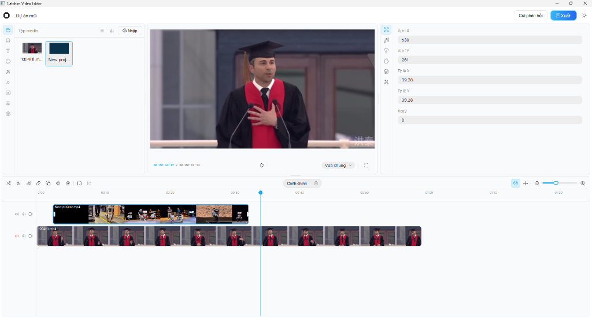
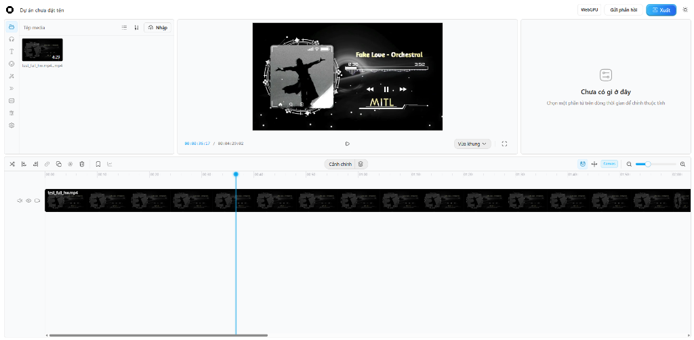

<p align="center">
  
</p>

# Catchim 🎬

Catchim is a high-performance video editing suite consisting of two main components: a native desktop application powered by C++ that can also compile to WebAssembly, and a modern browser-based editor.

## Screenshots

### Catchim Desktop App

<p align="center">
  
</p>

### Catchim Web Editor

Web-based video editor interface derived from OpenCut (https://github.com/OpenCut-app/OpenCut)

<p align="center">
  
</p>

## Architecture

Catchim is divided into two modules:

### App (`app/`)

The native desktop video editor written in C++ (C++20, Qt6, FFmpeg, GPU acceleration).
- Independent custom engine developed for maximum performance, hardware encoding (AMD AMF, NVIDIA NVENC, Intel QSV), and real-time timeline scrubbing.
- Can be compiled to WebAssembly via Emscripten (`catchim_browser_core`), allowing the core native engine to run directly inside web browsers.

### Web (`web/`)

The web-based video editor interface running on Next.js, React, Tailwind CSS, and WebGPU / Canvas rendering.
- Derived from the open-source OpenCut project.
- Enhanced with native WebAssembly engine bridges to communicate with the compiled C++ core.

## Directory Structure

```
catchim/
├── app/               # Native C++ desktop application & WASM engine
│   ├── src/           # Core engine, timeline, audio, media decoders, Qt UI
│   ├── tests/         # Engine & regression tests
│   ├── tools/         # Build & browser deployment scripts
│   └── CMakeLists.txt # C++ build configuration
├── web/               # Web video editor frontend (OpenCut based)
│   ├── src/           # React components, timeline, renderer, WebGPU
│   ├── public/        # Static assets and WebAssembly binaries
│   └── package.json   # Web dependencies & scripts
├── docs/              # Technical specifications, audits & screenshots
├── logo.svg           # Catchim vector logo
└── LICENSE            # Project license and copyright notices
```

## Quick Start

### Running Desktop App

Requirements: CMake 3.20+, C++20 compiler (MSVC / GCC / Clang), Qt 6.6+, FFmpeg.

Build with CMake:
```bash
cmake -S app -B app/build -DCMAKE_BUILD_TYPE=Release
cmake --build app/build --config Release
```

### Running Web Editor

Requirements: Node.js 18+ or Bun. `npm run dev` uses the checked-in browser WASM artifact. Building the web app also requires Rust/Cargo and the `wasm32-unknown-unknown` target.

```bash
cd web
npm install
npm run dev
```

After changing the Rust core, refresh its browser artifact with `npm run build:rust:wasm`. Both `npm run build` and `npm run build:browser` rebuild it automatically.

### Building C++ Core for Web

```powershell
./Build_Web.bat
```

## Community and Security

- [Security Policy](SECURITY.md): Vulnerability reporting procedures.
- [Code of Conduct](CODE_OF_CONDUCT.md): Contributor Covenant pledge and standards.
- [Contributing Guide](CONTRIBUTING.md): Setup and pull request guidelines.
- [Support](SUPPORT.md): Help and discussions.

## License and Attribution

- `app/`: Developed independently by KIYO GROUP (https://github.com/kiyogo). Licensed under the MIT License.
- `web/`: Derived from the open-source project OpenCut (https://github.com/OpenCut-app/OpenCut), copyright OpenCut Contributors, licensed under the MIT License.
