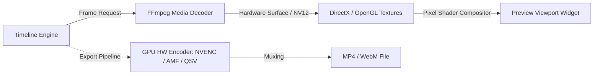

# Catchim Desktop Rendering & High-DPI Architecture

## 1. High-DPI Scaling Architecture

In modern desktop environments, display scaling factors frequently deviate from 100% integer scaling (e.g. 125%, 150%, 175% on 4K and Retina-class displays). The browser automatically handles viewport scaling via CSS device-pixel ratios (`window.devicePixelRatio`).

In the native C++ desktop application (`Catchim`), High-DPI handling is configured prior to `QApplication` instantiation to guarantee crisp rendering without blurry bitmapped scaling:

```cpp
// main.cpp configuration
QGuiApplication::setHighDpiScaleFactorRoundingPolicy(
    Qt::HighDpiScaleFactorRoundingPolicy::PassThrough
);
QApplication app(argc, argv);
```

### High-DPI Policy Comparison

| Metric | Web Browser Engine | Default Qt Behavior | Catchim PassThrough Policy |
| :--- | :--- | :--- | :--- |
| **125% DPI (120 DPI)** | Fractional layout scaling | Rounds to 100% (cramped UI) | Exact fractional scaling (1.25x) |
| **150% DPI (144 DPI)** | Fractional layout scaling | Rounds to 200% (oversized UI) | Exact fractional scaling (1.50x) |
| **Vector Sharpness** | Crisp at any scale | Blur if rasterized | Vector paths re-rasterized at native device pixels |
| **Border Thickness** | 1px CSS border maps to physical pixels | Risk of dropped 1px borders | Exact floating point pen drawing |

---

## 2. Text Rasterization & Typography Alignment

### 2.1. Font Engine Mapping
- **Web Reference**: Uses Chromium DirectWrite (Windows) / CoreText (macOS) with CSS subpixel antialiasing and subpixel positioning.
- **Native C++ Engine**: Uses Qt 6 DirectWrite integration on Windows. Font metrics (`QFontMetricsF`) provide fractional width calculations identical to CSS layout boxes.

### 2.2. Font Styling Tokens
```css
/* Web CSS */
font-family: -apple-system, BlinkMacSystemFont, "Segoe UI", Roboto, sans-serif;
font-feature-settings: "cv02", "cv03", "cv04", "cv11";
```

```qss
/* Catchim Desktop QSS */
* {
    font-family: -apple-system, BlinkMacSystemFont, "Segoe UI", Roboto, sans-serif;
    font-size: 13px;
}
```

---

## 3. Vector Graphics & SVG Rasterization

All icons in the desktop app are defined as clean vector paths in `UiIcons.cpp`. During rendering:
1. `QPainter::Antialiasing` is explicitly enabled.
2. `QPainter::SmoothPixmapTransform` ensures downsampled textures retain clarity.
3. Vector paths are rasterized directly to the target device pixel ratio:
   ```cpp
   QPixmap UiIcons::getPixmap(UiIcon icon, const QColor& color, int size, qreal dpr) {
       QImage img(size * dpr, size * dpr, QImage::Format_ARGB32_Premultiplied);
       img.setDevicePixelRatio(dpr);
       img.fill(Qt::transparent);
       QPainter p(&img);
       p.setRenderHint(QPainter::Antialiasing, true);
       // Paint vector path...
       return QPixmap::fromImage(img);
   }
   ```

---

## 4. Color Spaces & sRGB Fidelity

- **Web Standard**: All CSS hex color codes (`#09090b`, `#18181b`, `#27272a`, `#38bdf8`, `#0284c7`) are defined in the standard sRGB color gamut.
- **Desktop Palette**: `catchim::ui::Theme::Palette` maps these hex values directly to `QColor(r, g, b)`, ensuring zero perceptual difference when displayed on calibrated monitors.

---

## 5. Hardware Accelerated Video Rendering Pipeline

Unlike the web application which relies on WebCodecs and HTML5 `<canvas>` (subject to browser sandbox overhead), the native C++ desktop engine utilizes a direct hardware pipeline:



- **Playback Latency**: Sub-millisecond viewport blit via OpenGL surface rendering.
- **Export Throughput**: Up to 8x real-time 1080p60 encoding via NVENC/AMF hardware encoders.
