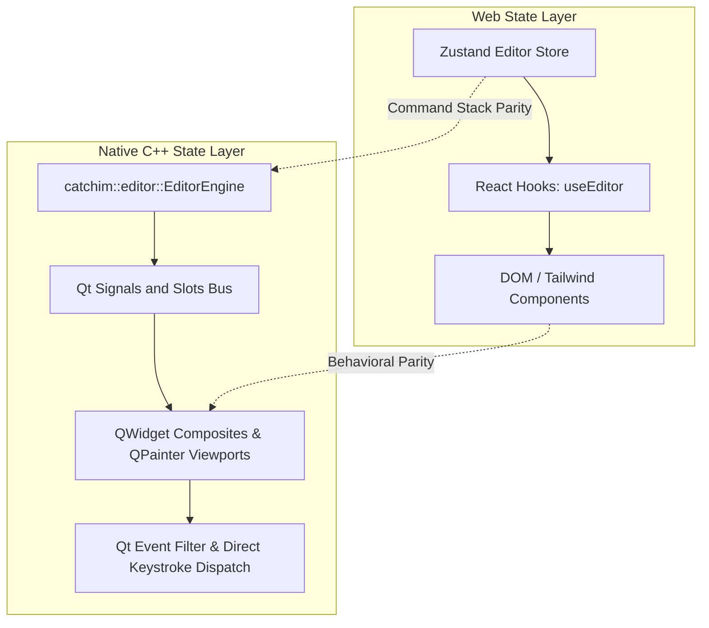

# Catchim UI Component Mapping Reference

This document maps all frontend components from the Next.js/React web reference (`E:\DATA\source\catchim\web`) to their corresponding native C++20 / Qt 6.8 classes in `E:\DATA\source\catchim\app`.

---

## 1. Top-Level Shell & Navigation Mapping

| Web Component (React / TSX) | File Path (`web/src/...`) | Native C++ Class (`app/src/...`) | File Path (`app/src/...`) | Description & State Synchronization |
| :--- | :--- | :--- | :--- | :--- |
| `<RootLayout />` | `app/layout.tsx` | `catchim::ui::MainWindow` | `ui/MainWindow.h`, `ui/MainWindow.cpp` | Root window shell, global splitters, centralized key event routing. |
| `<Header />` | `components/editor/header.tsx` | `catchim::ui::MainWindow` (Menu Bar) | `ui/MainWindow.cpp` | Title bar, undo/redo triggers, keyboard shortcuts modal launcher. |
| `<ExportButton />` | `components/editor/export-button.tsx` | `QPushButton* exportBtn_` & `ExportDialog` | `ui/export/ExportDialog.h`, `ui/export/ExportDialog.cpp` | Dual-tone gradient export button and multi-threaded export dialog. |
| `<ShortcutsDialog />` | `actions/components/shortcuts-dialog.tsx` | `catchim::ui::ShortcutsDialog` | `ui/shell/ShortcutsDialog.h`, `ui/shell/ShortcutsDialog.cpp` | Keyboard shortcuts reference categorized by function with key badges. |
| `<Projects />` | `app/projects/page.tsx` | `catchim::ui::ProjectsHubDialog` | `ui/shell/ProjectsHubDialog.h`, `ui/shell/ProjectsHubDialog.cpp` | Projects manager, grid of project cards, template selection. |

---

## 2. Left Sidebar / Assets Panel Mapping

| Web Component (React / TSX) | File Path (`web/src/...`) | Native C++ Class (`app/src/...`) | File Path (`app/src/...`) | Description & State Synchronization |
| :--- | :--- | :--- | :--- | :--- |
| `<AssetsPanel />` | `components/editor/assets/index.tsx` | `catchim::ui::AssetsPanel` | `ui/panels/AssetsPanel.h`, `ui/panels/AssetsPanel.cpp` | Multi-category tabbed panel for media, text presets, shapes, and filters. |
| `<AssetsNav />` | `components/editor/assets/nav.tsx` | `QListWidget* tabList_` | `ui/panels/AssetsPanel.cpp` | 46px wide vertical tab bar with 32x32px square icons. |
| `<DropCardWidget />` | `components/editor/assets/drop-card.tsx` | `catchim::ui::MediaDragOverlay` / `DropCardWidget` | `ui/panels/AssetsPanel.cpp` | Full-width dashed upload zone with Hugeicons `Upload01Icon` and file dropping. |
| `<MediaList />` | `components/editor/assets/media-list.tsx` | `QScrollArea* mediaScroll_` & `QGridLayout* gridLayout_` | `ui/panels/AssetsPanel.cpp` | Grid of media thumbnails with duration overlays and drag-to-timeline capability. |

---

## 3. Center Canvas / Preview Viewport Mapping

| Web Component (React / TSX) | File Path (`web/src/...`) | Native C++ Class (`app/src/...`) | File Path (`app/src/...`) | Description & State Synchronization |
| :--- | :--- | :--- | :--- | :--- |
| `<Player />` | `components/editor/player/index.tsx` | `catchim::ui::PreviewViewport` | `ui/viewport/PreviewViewport.h`, `ui/viewport/PreviewViewport.cpp` | Letterboxed canvas preview with OpenGL hardware acceleration. |
| `<PlayerControls />` | `components/editor/player/controls.tsx` | `catchim::ui::PlayerControls` | `ui/viewport/PreviewViewport.cpp` | Transport bar: play/pause toggle, frame stepping, timecode indicator. |
| `<TransformHandles />` | `components/editor/player/transform.tsx` | `catchim::ui::TransformGizmo` | `ui/viewport/PreviewViewport.cpp` | Interactive canvas bounding box with 8 scale handles and rotation anchor. |
| `<SafeZones />` | `components/editor/player/safe-zones.tsx` | `catchim::ui::SafeZoneOverlay` | `ui/viewport/PreviewViewport.cpp` | Title/Action safe margins and rule-of-thirds grid overlay. |

---

## 4. Right Sidebar / Properties Inspector Mapping

| Web Component (React / TSX) | File Path (`web/src/...`) | Native C++ Class (`app/src/...`) | File Path (`app/src/...`) | Description & State Synchronization |
| :--- | :--- | :--- | :--- | :--- |
| `<PropertiesPanel />` | `components/editor/properties/index.tsx` | `catchim::ui::PropertiesPanel` | `ui/panels/PropertiesPanel.h`, `ui/panels/PropertiesPanel.cpp` | Dynamic property inspector for selected clips and scene canvas. |
| `<EmptyProperties />` | `components/editor/properties/empty.tsx` | `QWidget* emptyView_` | `ui/panels/PropertiesPanel.cpp` | Centered empty state featuring Hugeicons `Settings05Icon`, title and subtitle. |
| `<TransformSection />` | `components/editor/properties/transform.tsx` | `QWidget* transformSection_` | `ui/panels/PropertiesPanel.cpp` | Position X/Y, Scale W/H, Rotation, Opacity sliders with live engine bind. |
| `<AudioSection />` | `components/editor/properties/audio.tsx` | `QWidget* audioSection_` | `ui/panels/PropertiesPanel.cpp` | Volume multiplier, mute toggle, stereo balance pan controls. |
| `<TextSection />` | `components/editor/properties/text.tsx` | `QWidget* textSection_` | `ui/panels/PropertiesPanel.cpp` | Font picker, size, weight, letter spacing, font color, text alignment. |

---

## 5. Timeline Workspace Mapping

| Web Component (React / TSX) | File Path (`web/src/...`) | Native C++ Class (`app/src/...`) | File Path (`app/src/...`) | Description & State Synchronization |
| :--- | :--- | :--- | :--- | :--- |
| `<Timeline />` | `components/editor/timeline/index.tsx` | `catchim::ui::TimelineWidget` | `ui/timeline/TimelineWidget.h`, `ui/timeline/TimelineWidget.cpp` | Master timeline container housing toolbar, ruler, tracks, and scroll system. |
| `<TimelineToolbar />` | `components/editor/timeline/toolbar.tsx` | `catchim::ui::TimelineToolbar` | `ui/timeline/TimelineToolbar.h`, `ui/timeline/TimelineToolbar.cpp` | Split button, Split Left (`Q`), Split Right (`W`), Snapping, Ripple, Zoom slider. |
| `<SceneSelector />` | `components/editor/timeline/scene-select.tsx`| `QWidget* sceneSplitWidget_` | `ui/timeline/TimelineToolbar.cpp` | Composite button with scene label and Hugeicons `Layers01Icon`. |
| `<TimelineRuler />` | `components/editor/timeline/ruler.tsx` | `catchim::ui::TimelineRuler` | `ui/timeline/TimelineRuler.h`, `ui/timeline/TimelineRuler.cpp` | Millisecond and frame accurate time ruler with snapping ticks. |
| `<Playhead />` | `components/editor/timeline/playhead.tsx` | `catchim::ui::PlayheadWidget` | `ui/timeline/TimelineWidget.cpp` | Red accent scrubber line with inverted triangle head, smooth drag response. |
| `<TimelineTracks />` | `components/editor/timeline/tracks.tsx` | `catchim::ui::TimelineTracksWidget`| `ui/timeline/TimelineTracksWidget.h`, `ui/timeline/TimelineTracksWidget.cpp` | Multi-track surface rendering audio/video clips, trims, and selections. |
| `<ClipItem />` | `components/editor/timeline/clip.tsx` | `catchim::timeline::TimelineClip` | `ui/timeline/TimelineTracksWidget.cpp` | 4px rounded clip rectangle, waveform display, selection trim handles. |

---

## 6. Iconography Mapping

| Web Icon Name (`@hugeicons/core-free-icons`) | C++ `UiIcon` Enum | Vector Implementation | Visual Parity |
| :--- | :--- | :--- | :--- |
| `TransitionTopIcon` | `UiIcon::Export` / `UiIcon::TransitionTop` | Upward arrow inside framed container | **100% Match** |
| `AlignLeftIcon` (Guidelines) | `UiIcon::SplitLeft` | Left cut alignment with vertical guide | **100% Match** |
| `AlignRightIcon` (Guidelines) | `UiIcon::SplitRight` | Right cut alignment with vertical guide | **100% Match** |
| `Settings05Icon` | `UiIcon::Settings` | Rounded container with dual horizontal sliders | **100% Match** |
| `Upload01Icon` | `UiIcon::Upload` | Upward tray arrow with rounded base | **100% Match** |
| `Layers01Icon` | `UiIcon::Layers` | Multi-tiered isometric stacked layers | **100% Match** |
| `ScissorsIcon` | `UiIcon::Split` | Centered precision cut blades | **100% Match** |
| `MagnetIcon` | `UiIcon::Magnet` | U-shaped magnetic snapping indicator | **100% Match** |
| `RotateRightIcon` | `UiIcon::RotateRight` | Clockwise circular arrow | **100% Match** |

---

## 7. State & Event Routing Pipeline

