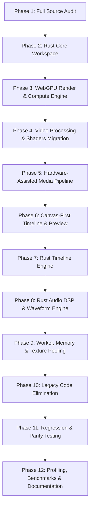

# MIGRATION PLAN — REBUILDING VIDEO EDITOR ENGINE WITH RUST + WEBGPU

## 1. Migration Goals & Boundaries

The migration transforms the web editor from a hybrid TypeScript/Canvas2D model into a high-performance **Rust-powered, WebAssembly-based, WebGPU-accelerated, Canvas-first video editor**.

### Key Rules:
1. **Preserve 100% Visual and Functional Parity**: All layouts, colors, themes, keyboard shortcuts, project files, and panel behaviors remain identical.
2. **True Processing, No Stubs**: Shaders, filters, blending, waveforms, audio mixing, and export pipelines must execute real algorithms.
3. **No Legacy TypeScript Engine Retained**: After verification, all heavy TypeScript loops and software fallbacks are superseded by the Rust/WebGPU engine.
4. **Zero-Copy & GPU Acceleration First**: Direct `VideoFrame` -> `GPUTexture` -> WebGPU SwapChain pipelines where browser capabilities allow.

---

## 2. Phased Migration Schedule

---

## 3. Detailed Phase Breakdown

### Phase 2: Rust Core Workspace (`rust/crates/opencut_engine`)
- Establish Rust workspace with high-performance crates.
- Build pure Rust modules:
  - `time`: `MediaTime` (120,000 integer ticks/sec), timecode formatting/parsing, frame snapping.
  - `timeline`: Interval tree clip collision index, spatial query, gap finding, ripple editing.
  - `animation`: Cubic bezier solver, channel interpolation (scalar, discrete, easing curves).
  - `audio`: SIMD-accelerated mixing, resampling, gain ramps, RMS/peak buckets.
  - `effects`: Software & GPU shader definitions for color grading, gaussian blur, vignette, chroma key.
  - `masks`: Analytical shape generation, bezier path rasterization, feathering.
  - `compositor`: 12 standard blend modes, quad transformation matrices.
  - `canvas`: Timeline canvas drawing instructions and dirty region tracking.
  - `ffi`: C ABI exports and wasm-bindgen interoperability.

### Phase 3: WebGPU Render & Compute Engine
- WGSL shaders:
  - `compositor.wgsl`: Multi-layer quad rendering with arbitrary transforms, opacity, and 12 blend modes.
  - `blur.wgsl`: Separable horizontal and vertical Gaussian blur compute shader.
  - `color_grade.wgsl`: Compute shader for exposure, brightness, contrast, saturation, temperature, tint, hue, gamma.
  - `vignette.wgsl`: Radial vignette shader with softness and aspect ratio adaptation.
  - `chroma_key.wgsl`: Real-time green/blue screen suppression with similarity and spill controls.
  - `mask.wgsl`: Compute pass for alpha masking and smooth feather blending.
  - `waveform.wgsl`: Compute pass for parallel audio buffer peak and RMS extraction.
- GPU device manager with fallback detection (`navigator.gpu` support, adapter request, device loss recovery).
- Texture pool and buffer pool to prevent VRAM fragmentation.

### Phase 4: Video Processing Migration
- Transition all image filtering, blur, and color operations from CPU `getImageData` to WebGPU compute passes.
- Implement unified render tree traversal that submits draw calls to WebGPU command encoders.

### Phase 5: Hardware-Assisted Media Pipeline
- WebCodecs `VideoDecoder` and `VideoEncoder` integration.
- Hardware texture import: `device.importExternalTexture({ source: videoFrame })` or `copyExternalImageToTexture` directly into WebGPU textures without CPU readback.
- Synchronized audio-video export pipeline through WebCodecs and container muxers.

### Phase 6: Canvas-First UI
- Replace thousands of DOM elements in the timeline with a high-performance `<canvas>` element:
  - Timeline Canvas Renderer: Draws time ruler, second/frame ticks, timecode labels, track backgrounds, clip boxes, waveform graphs, thumbnail strips, keyframe diamonds, and playhead.
  - Viewport virtual culling: Only draw tracks and clips within the visible scroll window.
  - Dirty-region updates: Do not redraw static clips when only the playhead moves.

### Phase 7: Rust Timeline Engine
- Route all timeline placement queries (`canPlace`, `findAvailableGap`, `applyRipple`, `snapPoints`) through WASM.
- Replace JavaScript WeakMap caches with native Rust interval indexing.

### Phase 8: Rust Audio DSP Engine
- Replace single-threaded JS audio loops with Rust SIMD routines for:
  - Stereo downmixing
  - Multi-track buffer accumulation
  - Non-linear speed retiming & pitch preservation
  - Peak and RMS bucket calculation

### Phase 9: Worker, Memory & Resource Optimization
- Dedicated rendering and export worker architecture.
- Texture pooling with LRU eviction and memory budget enforcement.
- Strict cleanup of `GPUTexture`, `GPUBuffer`, and `VideoFrame` instances.

### Phase 10: Legacy Code Elimination
- Remove deprecated software compositing pathways and unneeded TypeScript calculation helpers.

### Phase 11 & 12: Comprehensive Verification & Benchmarks
- Run Vitest regression suites and Cargo unit tests.
- Measure FPS, frame time, seek latency, memory consumption, and export duration.
- Finalize all technical architecture documents in `docs/`.
