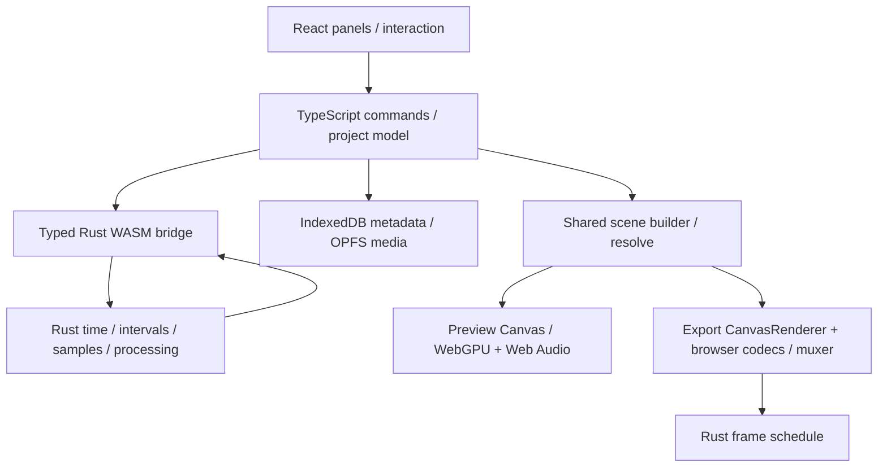

# Catchim Web: Rust/WASM and TypeScript boundaries

Updated 2026-10-23. Scope: the editor under `web/`. The native Qt application under `app/` is a separate implementation and does not establish web feature coverage.

## Runtime topology

The existing Next.js/React application owns browser interaction and lifecycle. The dependency-free Rust crate at `rust/crates/opencut_engine/` compiles to `wasm32-unknown-unknown`. `scripts/build-rust-wasm.mjs` validates required exports and copies the artifact to `public/wasm/opencut_engine.wasm`.

`src/native/rust-engine.ts` loads that artifact and adapts its C ABI to typed browser interfaces. `src/native/opencut-core.ts` prefers Rust and retains the existing Emscripten implementation as a compatibility fallback. Some algorithms still have TypeScript compatibility paths. The presence of a Rust module/export does not mean every UI operation uses it.

## Ownership

| Concern | Owner and integration |
| --- | --- |
| UI, drag/drop, focus, keyboard, selection, React subscriptions | TypeScript. Preserve component APIs and existing visual layout when changing an adapter. |
| Project/track/element identity, history and browser storage lifecycle | Existing TypeScript domain and command model. Rust supplies validated edit plans; it does not independently mutate a second project model. |
| Time, interval/collision/snapping, sample algorithms | Prefer Rust pure functions through the existing bridge; preserve tested compatibility for older or unavailable WASM. |
| Media file handles, URLs, codec discovery, decode/encode, permission prompts, AudioContext and GPU resources | Browser APIs coordinated in TypeScript. Rust/WASM here does not run a native executable or FFmpeg binary inside the browser. |
| GPU work | Canvas/WebGPU adapter and compositor use real browser resources. Embedded WGSL is a capability, not proof of a wired feature, hardware acceleration or preview/export equivalence. |
| AI/model features | Explicit transcription/model/provider services. A local deterministic approximation is not evidence of the corresponding learned CapCut behavior. |

## Rust modules connected in the current editor

- `time.rs`: 120,000 ticks/second, frame helpers, timecodes and subtitle timestamp parsing/formatting. Existing snapping helpers require an integral ticks-per-frame for a rate; this is not universal arbitrary-rational frame support.
- `export.rs`: `ExportTiming` calculates frame count using exact integer ceil, then rational presentation timestamps and sample durations. A final partial frame is capped to the remaining timeline duration. Quantized render ticks remain inside the exclusive timeline end.
- `gap_edit.rs`: compacts positive interior gaps between connected interval components, preserving the earliest position, overlaps and input order. Returns starts without changing IDs, source references, trims, duration or rate.
- `timeline.rs`: existing interval placement/gap/ripple/snapping data structures and functions. Check each caller before claiming it uses Rust.
- `audio.rs`: sample processing/analysis and decoded-buffer scheduling. The scheduling ABI uses seconds and clips audible windows to trim/split/seek boundaries.
- `animation.rs`, `masks.rs`, `compositor.rs`, `effects.rs`, `canvas.rs`, `gpu.rs`, `ui.rs`: existing math/rendering/layout capabilities. Inspect call sites and registry wiring for actual feature status. For example, the default TS effect registry currently exposes blur; this is not a complete color/effects catalog.

## Editing planner ABI

| Export | Contract |
| --- | --- |
| `ocw_export_frame_count(durationTicks, fpsNum, fpsDen)` | Returns a nonnegative exact count representable as a JS safe integer; `-1` means invalid input/result. |
| `ocw_export_frame_sample(durationTicks, fpsNum, fpsDen, index, outF64x3)` | `1` writes render ticks, presentation seconds and duration seconds; `0` means outside the frame range; `-1` means invalid. |
| `ocw_timeline_compact_gaps(startsF64, durationsF64, count, outStartsF64)` | `1` writes starts in input order, `-1` rejects invalid ranges. Zero elements returns success without dereferencing arrays. ABI limits count to 1,000,000. |
| `ocw_audio_plan_buffer_schedule(...)` | Existing scheduling contract: invalid/empty/ready status with a four-value window. Source offset/duration are buffer seconds, independent of playback rate. |
| `ocw_subtitles_parse_timestamp` / `ocw_subtitles_format_timestamp` | Existing subtitle ABI, hardened to reject malformed timestamp fields, guard null/zero-size output and carry millisecond rounding correctly. |

Bridge validation rejects nonfinite, fractional or unsafe tick/index values and invalid u32 frame rates before WASM coercion. C ABI pointer functions trust memory allocated by the bridge; arbitrary pointers are not a safe public application API.

Allocation ownership is explicit: `oc_malloc` returns a pointer with an internal size header; its matching `oc_free` must run exactly once. Scratch allocations are freed in `finally`. Typed memory views must be recreated after allocations or calls that can grow WASM memory. Typed bridge results are copies, not dangling views.

## Lifecycle and history

- A gap edit runs through `CommandManager`. `Command.appliesOwnRipple` lets a command that already plans timing opt out of the manager's automatic ripple pass during execute and redo. Other commands retain the default policy. Locked/no-op tracks do not acquire an extra history entry through the gap action.
- Generated TTS audio is persisted as a media asset before its upload-audio element is inserted. The synthesis URL is transient and revoked. A serialized `blob:` URL or in-memory `AudioBuffer` alone is not persistent media.
- Export creates an `AbortController` before audio preparation. TypeScript propagates its signal through fetch/decode/retime/mix/mastering, yields between bounded work chunks, disposes decoder inputs and closes only contexts owned by the job.
- `decodeAudioData` and `OfflineAudioContext.startRendering` cannot be fully interrupted by an AbortSignal. The wrapper rejects promptly, ignores late results and disconnects/releases what the browser API allows. Encoder finalization also has API limits; do not claim instantaneous native cancellation.
- Subtitle file parsing/serialization and downloads are TypeScript adapters around track data and Rust-backed timestamp functions. A sidecar explicitly exports one chosen text track; no alternate caption project model is introduced. WebVTT layout/styles are imported as plain text with warnings where metadata/settings are encountered.

## Verification and limits

Run `cargo test --manifest-path rust/crates/opencut_engine/Cargo.toml`, `npm run build:rust:wasm`, focused `npx vitest run`, and `npx tsc --noEmit` for changed boundaries. Real-WASM differential tests cover editing planners, audio scheduling and subtitle timing. Exporter integration tests verify encoder timestamps/durations and cleanup using mocks; those are not a golden encoded-video comparison.

No benchmark in this work proves acceleration, multithreaded throughput, zero drift, bit-identical output across platforms or complete memory safety of all unsafe ABI callers. Browser playback, GPU-loss behavior and MP4/WebM output still require runtime QA. Current automation is disabled in Work settings; HTTP checks only establish that the local server serves the route/artifact.

Feature evidence and remaining work: [VIDEO_EDITOR_FEATURE_MATRIX.md](./VIDEO_EDITOR_FEATURE_MATRIX.md) and [CAPCUT_WEB_PARITY_2026-10-23.md](./CAPCUT_WEB_PARITY_2026-10-23.md).

## MCP integration boundary

`src/mcp/` provides a local MCP server and a browser connection bridge. TypeScript owns MCP/HTTP validation, ephemeral credentials, connection lifecycle, permissions and UI; tool adapters invoke the existing EditorCore commands and the existing WASM time conversion. Timeline placement, split/source mapping, gap compaction, rendering and color processing keep their existing owners in Rust/WASM and browser adapters. No second editing engine or project schema is introduced. See [MCP.md](./MCP.md).

## Caption timing and selected exports (2026-10-23)

`caption_edit.rs` owns cue-range validation, atomic offsets, split durations and merged interval unions. `native/caption-timing.ts` adapts aligned f64 arrays; `subtitles/timing.ts` keeps compatibility with older artifacts only when the capability is absent. `EditCaptionTrackCommand` edits the existing text track through the standard CommandManager and update pipeline, preserving identity, locks, undo/redo and animation boundaries.

`export.rs::ExportRange` validates a half-open `[start,end)` window within the timeline. `ocw_export_resolve_range` returns start/end/duration, with safe-integer validation on both sides. SceneExporter schedules frames over the range duration and renders at `start + local_sample_tick`; encoded timestamps begin at zero. The same tick range is passed to audio candidate collection before fetch/decode, and the mixer retains each clip's original local trim, retime and volume-envelope clock.

`audio_export.rs::encode_pcm16` owns planar-to-interleaved sample quantization, finite-value handling and little-endian PCM16 serialization. `native/audio-export.ts` copies bounded chunks (at most 65,536 frames) through WASM scratch memory and frees it in every branch. `export/wav.ts` writes the RIFF container and yields between chunks for cancellation. Audio-only export bypasses CanvasRenderer, WebGPU and the video encoder.

New required ABI exports: `ocw_caption_validate_range`, `ocw_caption_offset_ranges`, `ocw_caption_split_range`, `ocw_caption_merge_ranges`, `ocw_export_resolve_range`, `ocw_audio_encode_pcm16`. Build synchronization verifies all six. No project/storage schema change is introduced by these workflows.

## Standalone deployment contract

Next.js standalone output requires `.next/static` and `public` to be copied beside `server.js`. `scripts/prepare-standalone.mjs` runs after Next build, `scripts/start-standalone.mjs` verifies those files and defaults PORT to 3300, and `scripts/check-web-assets.mjs` fetches all JS/CSS referenced by selected page routes and compiles the served WASM. Serving HTML with status 200 does not establish that the editor client can load.
